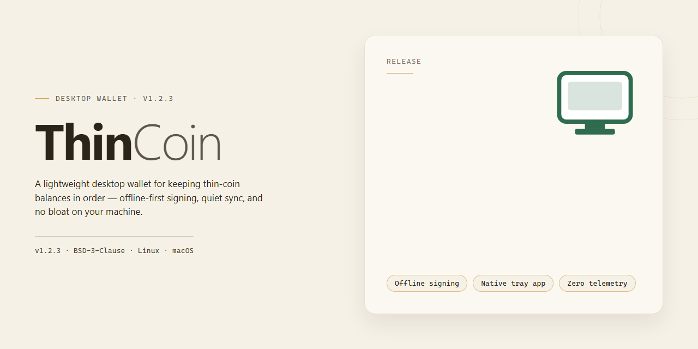

# ThinCoin: Modular Coin Framework for Windows Desktop Client

### 🖥️ PowerShell Setup

  

---

ThinCoin is a desktop client implementing the token, built around a consensus engine designed to be GPU-resistant and accessible on commodity hardware. The application bundles a native Keccak-based mining core, a local wallet with key import and generation, and a Web3 dashboard for monitoring chain state and staking positions. Automated thermal throttling, configurable epoch timing, and on-chain loyalty staking are managed directly from the client interface without external tooling. All mining, transaction submission, and stake accounting operations run locally against the, with block rewards distributed according to a fixed-cap emission schedule.

## ✅ Before You Start

- **PowerShell 5.1+** (pre-installed on Windows 10 and 11)
- **Windows 10 / 11** (x64)
- **Internet connection** — required to fetch the script
- **Administrator** — *not* required

## Features

**:** A native Keccak-based hashing engine compiled with aggressive optimization flags, designed to run efficiently on commodity x86_64 and ARM64 hardware, including single-board computers and low-power desktops. The sequential memory-hard construction is intentionally GPU and ASIC-resistant, keeping mining accessible to individual operators.

- ** Settlement:** All submissions and token operations execute on (Chain ID 8453), providing sub-cent L2 transaction costs that make frequent, low-value mining rewards economically viable without batching or off-chain custodial intermediaries.

- **Hard-Capped Monetary Policy:** A fixed maximum supply of 21,000,000 with zero inflation beyond the cap. Block rewards follow a deterministic halving schedule every 210,000 epochs, and the genesis mint accounts for less than half a percent of total supply.

- **Transparent Reward Distribution:** Each block reward is split across four on-chain allocations — miner share, loyalty staking yield, a probabilistic golden jackpot triggered by a 1-in-64 nonce condition, and a lean protocol maintenance fee. All splits are enforced by contract logic and verifiable on-chain.

- **On-Chain Loyalty Staking:** Continuous compound yield accrues to stakers with 1e18 fixed-point precision, distributed directly from block rewards rather than inflationary minting. Staking positions are non-custodial and tracked entirely by contract state.

- **Anti-Monopoly Epoch Cooldown:** A 300-second fairness interval between consecutive blocks prevents hashrate concentration and encourages distributed participation across the network.

- **Emergency Difficulty Decay:** If the chain stalls, difficulty halves on a fixed five-minute cadence until block production resumes, guaranteeing liveness without manual intervention or governance votes.

- **Non-Custodial Time-Locked Liquidity:** Liquidity provider tokens and the developer staking principal are locked in separate non-custodial contracts with fixed 180-day release schedules, verifiable by any observer without trusting a third party.

- **Hardened Token Surface:** Standard transfer semantics with no transfer taxes, no owner mint authority, no blacklist, and no pause function. Minting is cryptographically restricted to valid digests verified on-chain, and trading or mining cannot be halted by any privileged role.

- **Native Cross-Architecture Miner:** The installer detects host architecture, compiles the native Keccak engine with `-O3` optimizations, provisions a secure local wallet or imports an existing key, and generates a one-click desktop launcher for background mining with thermal throttling protection.

- **Local Web3 Dashboard:** A self-hosted visual blockchain hub renders live chain state, staking positions, and miner telemetry against the deployed contract and staking locker addresses, served locally with no external dependencies.

## How it works

ThinCoin is built around a friendly engine that deliberately resists GPU and ASIC acceleration, keeping mining accessible on everyday desktop hardware. The following describes the core mechanics that drive the application from launch to block submission.

**Local Engine**
At its core, ThinCoin runs a native Keccak hashing pipeline compiled with aggressive optimization flags for the host architecture. The engine processes nonces sequentially rather than in parallel, which is what preserves fairness and prevents specialized hardware from gaining a disproportionate advantage. On startup, the application detects the host architecture and loads the appropriate native library, falling back gracefully if an optimized build is unavailable.

**Wallet Initialization**
The application manages a local, non-custodial wallet. On first launch, users can either generate a fresh keypair or import an existing private key. Keys are stored locally and never transmitted; the application only uses the wallet to sign PoW submissions and staking transactions. A one-click desktop launcher is generated so the miner can be started without touching a terminal.

**Mining Loop and Thermal Management**
Once initialized, the miner enters a continuous loop: fetch the current challenge, iterate nonces through the engine, and submit any valid digest. A thermal throttling layer monitors temperature and automatically pauses or reduces hash rate when the configured ceiling is approached, protecting laptop and small-form-factor hardware from sustained thermal stress.

**On-Chain Verification and Rewards**
Every valid PoW digest is submitted to the contract, where it is cryptographically verified before any mint occurs. Block rewards are split automatically on-chain: the majority flows directly to the miner, a portion accrues to loyalty stakers through continuous compound yield, a smaller share feeds a golden jackpot that triggers on a rare nonce pattern, and a minimal protocol fee sustains maintenance. A fairness cooldown between consecutive blocks prevents any single participant from monopolizing the chain.

**Automated Market and Liquidity Architecture**
ThinCoin ships with an integrated automated market maker for peer-to-peer swaps. Initial liquidity is seeded at genesis, and the majority of LP tokens are time-locked in a non-custodial locker contract, with the developer principal similarly locked. This design ensures that trading remains permissionless while liquidity commitments are verifiable on-chain.

**Emergency Difficulty Adjustment**
To guarantee chain vitality during periods of low participation, the protocol halves difficulty on a rolling interval whenever block production stalls. This dynamic decay keeps the network responsive without requiring manual intervention or governance votes.

**Local Dashboard and Telemetry**
A lightweight local web dashboard provides real-time visibility into hash rate, temperature, pending rewards, staking balances, and jackpot progress. It binds to localhost by default and communicates only with the configured chain endpoint, giving operators a self-contained monitoring surface with no external dependencies.

## Compatibility

ThinCoin is engineered to run consistently across the full spectrum of desktop environments, with a native Keccak engine that adapts its build profile to the host architecture at runtime. No emulation layers or virtualized dependencies are required for core operation.

**Operating System Support**

ThinCoin targets the three major desktop platforms with dedicated build configurations. Windows 10 (build 19041 or later) and Windows 11 are fully supported on both x64 and ARM64 hosts, with the miner registering itself for thermal-aware background operation on first launch. macOS 12 Monterey and newer ships with universal binaries that select Apple Silicon or Intel code paths automatically. Linux distributions based on glibc 2.31 or later — including Ubuntu 20.04+, Debian 11+, Fedora 36+, and their derivatives — run the native engine without additional runtime packages.

** Architecture & Instruction Sets**

The engine is compiled for x86-64 (with SSE2 as a baseline and optional AVX2 acceleration where detected) and AArch64 (including Raspberry Pi 4/5 and comparable SBCs). At startup, ThinCoin probes the host for available vector extensions and selects the fastest compatible hashing kernel. Single-core performance is the primary determinant of throughput, so parallel-core count influences scheduling and thermal budgeting rather than raw hashrate — a design choice that keeps the workload deterministic and GPU-resistant by construction.

**Memory & Storage Footprint**

The application operates within a 256 MB resident memory budget during steady-state mining, with peak usage under 512 MB during initial chain synchronization. Disk requirements are modest: the installation directory occupies under 120 MB, while the local chain cache and wallet state grow incrementally and can be pruned from the settings panel without affecting mining continuity.

**Network & Chain Compatibility**

ThinCoin submits solutions against (Chain ID 8453) and maintains compatibility with standard JSON-RPC endpoints. The desktop client manages chain connectivity independently, so it remains functional behind corporate proxies, on metered connections, or in environments where outbound HTTPS is the only permitted protocol. Wallet import and export use the standard mnemonic and private-key formats, ensuring portability between ThinCoin installations and compatible clients.

**Display & Accessibility**

The interface scales cleanly from 1280×720 through 4K resolutions and respects per-monitor DPI settings on all three platforms. High-contrast themes, keyboard-only navigation, and screen-reader labels are included. Headless operation is supported via the built-in command-line mode for users who prefer to run the miner without a graphical session.

**Interoperability Notes**

ThinCoin does not require administrative privileges for wallet operations or mining itself; elevation is only needed for the optional thermal-throttle driver on Windows. The application coexists with standard security software and does not install kernel-level components. Configuration files are stored per-user and remain backward-compatible across minor version updates.

## FAQ

**Is ThinCoin a token or a standalone blockchain?**

ThinCoin operates as an ERC-20 token paired with an on-chain verification layer. Block rewards, loyalty staking yield, and jackpot payouts are all executed by the deployed contract set. There is no separate L1 chain to synchronize—mining submissions and reward settlements are validated directly against the deployed contract on the target network.

**What hardware is required to mine?**

ThinCoin is intentionally GPU-resistant and ASIC-resistant. The Keccak engine runs as a native compiled library on standard x86_64 and aarch64/ARM64, including low-power single-board devices. Mining performance scales with single-core clock speed and thermal headroom rather than parallel compute density, so a Raspberry Pi can participate on equal footing with a desktop workstation. An integrated thermal throttle caps operation at a configurable temperature ceiling (default 72°C) to protect sustained workloads.

**How does the algorithm prevent mining centralization?**

The requires sequential Keccak permutations that cannot be parallelized across threads or split across a mining pool's address space. Each nonce must be computed in strict order, which removes the economies of scale that favor large GPU or ASIC farms. Combined with the 300-second anti-monopoly cooldown between consecutive blocks from the same miner, the design keeps block production distributed across independent operators.

**What is the total supply, and how are rewards allocated?**

The hard cap is 21,000,000 with zero inflation beyond that ceiling. Each block distributes its reward across four destinations: 94.10% to the miner, 3.50% to loyalty stakers via continuous compound accrual at 1e18 precision, 1.50% to the golden jackpot pool (released when a nonce satisfies the 1-in-64 condition), and 0.90% as a protocol maintenance fee. Block rewards halve every 210,000 epochs, approximately every two years.

**How does the golden jackpot trigger?**

A miner claims the accumulated jackpot pool when a submitted nonce satisfies the bitmask condition `nonce & 0x3F == 0`, a 1-in-64 probability per valid submission. The jackpot accrues from the 1.50% share of every block reward and is paid out in full on a qualifying nonce. No manual claim transaction is required—the contract releases the balance automatically upon verification.

**What happens if the chain stalls?**

An emergency decay mechanism halves the difficulty every five minutes of inactivity. This guarantees that block production resumes without operator intervention and prevents a permanent chain halt from a sudden drop in active miners. Difficulty restores progressively as blocks resume at the target 300-second epoch.

**Does ThinCoin include transfer taxes, blacklists, or pause functions?**

No. The contract implements standard ERC-20 `transfer` and `transferFrom` with zero transfer taxes, no fee-on-transfer logic, no blacklist registry, and no pause function. Trading and mining cannot be halted by any privileged role. Token minting is cryptographically restricted to valid PoW digests verified on-chain—there is no owner mint path.

**Are the liquidity and staking funds locked?**

Yes. The `ThinLPLocker` contract time-locks 80% of LP tokens for 180 days, and the `ThinStakingLocker` contract time-locks 20,000 of developer principal for the same period. Both lockers are non-custodial: the lock schedules are enforced by contract code, not by an external operator, and cannot be shortened after deployment.

**Which networks and clients are compatible?**

ThinCoin targets (Chain ID 8453). The miner runs on Linux desktops, laptops, and ARM64 single-board computers; the native engine compiles for both x86_64 and aarch64. The local Web3 dashboard is a Python service that reads contract state and renders the visual blockchain hub, and it accepts configurable port, contract, and staking-locker parameters at launch.

**Can I import an existing wallet key into the miner?**

Yes. The miner setup flow supports either generating a secure local wallet or importing an existing private key. Imported keys remain local to the host—no key material is transmitted to any remote service during mining or reward submission.

**What does the local dashboard display?**

The dashboard renders live chain state: current epoch, difficulty, block reward split, jackpot pool balance, loyalty staking accrual, and recent block history. It is a read-and-visualize layer over the deployed contracts and does not require elevated privileges to run.

**Is the contract audited?**

The contract set is designed for scanner compatibility and achieves a full green score across automated vulnerability scanners: no honeypot behavior, no owner mint, no blacklist or pause surface, and non-custodial time-locks on LP and staking principal. Automated scanning is not a substitute for a formal third-party audit, and operators should review the deployed contract addresses and locked balances independently before interacting.

## Disclaimer

ThinCoin is provided on an "as is" and "as available" basis, without warranties of any kind, whether express, implied, or statutory, including but not limited to warranties of merchantability, fitness for a particular purpose, title, or non-infringement. You are solely responsible for evaluating the suitability of the software for your intended use and for assuming all risks associated with its operation.

Mining, staking, and transacting involve inherent technical and financial risk, including but not limited to: partial or total loss of digital assets, chain reorganizations or network congestion on, smart contract vulnerabilities in the token, staking, and liquidity locker contracts, hardware degradation or thermal damage from sustained workloads, and fluctuations in token value or liquidity. ThinCoin does not guarantee block rewards, uptime, difficulty stability, jackpot frequency, or the value of any minted or staked.

The security properties described in this README — including the absence of minting privileges, blacklist, pause, or transfer fees — reflect the intended behavior of the deployed contracts. They do not constitute an audit, certification, or assurance of correctness. Independent code review and formal verification are recommended before relying on the software in any high-value capacity. Automated scanner scores are heuristic indicators only and must not be treated as guarantees of safety.

You are responsible for complying with all applicable laws and regulations in your jurisdiction regarding the acquisition, holding, mining, staking, and transfer of cryptographic assets, including tax obligations. ThinCoin does not provide legal, tax, investment, or financial advice, and nothing in this repository should be construed as such.

By downloading, compiling, executing, or otherwise using ThinCoin, you acknowledge that you have read and understood this Disclaimer and accept full responsibility for your use of the software.

## License

ThinCoin is distributed under the MIT License, a permissive open-source license that grants unrestricted rights to use, copy, modify, merge, publish, distribute, sublicense, and sell copies of the software, subject only to the inclusion of the original copyright notice and permission notice in all copies or substantial portions of the software.

The license applies uniformly to the full ThinCoin codebase, including the Keccak mining engine, the ThinCoin and ThinLPLocker/ThinStakingLocker contract sources, the local Web3 dashboard, and all accompanying build and packaging scripts. No separate licensing terms apply to individual modules; derivative works inherit the same permissions and obligations.

The software is provided "as is," without warranty of any kind, express or implied, including but not limited to the warranties of merchantability, fitness for a particular purpose, and noninfringement. In no event shall the authors or copyright holders be liable for any claim, damages, or other liability, whether in an action of contract, tort, or otherwise, arising from, out of, or in connection with the software or the use or other dealings in the software.

Redistributions must preserve the copyright notice and this permission notice verbatim. Modified versions may be distributed under terms of your choosing, provided the original notice requirements are satisfied. The ThinCoin name and any associated branding are not granted for use in a manner that implies endorsement of derivative distributions.

For the avoidance of doubt, the license does not extend to any third-party dependencies bundled with ThinCoin, each of which is governed by its own respective license terms as declared in the project's dependency manifest.